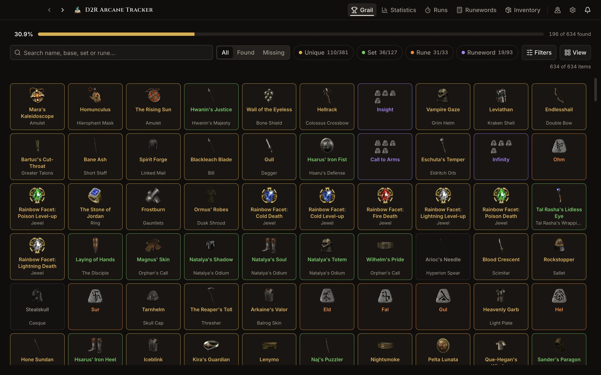
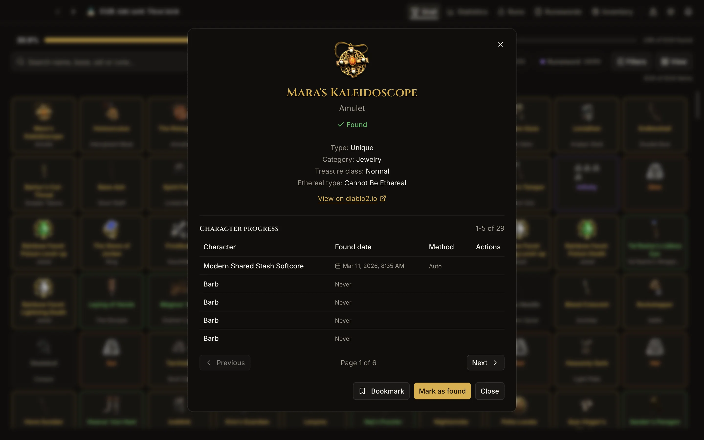
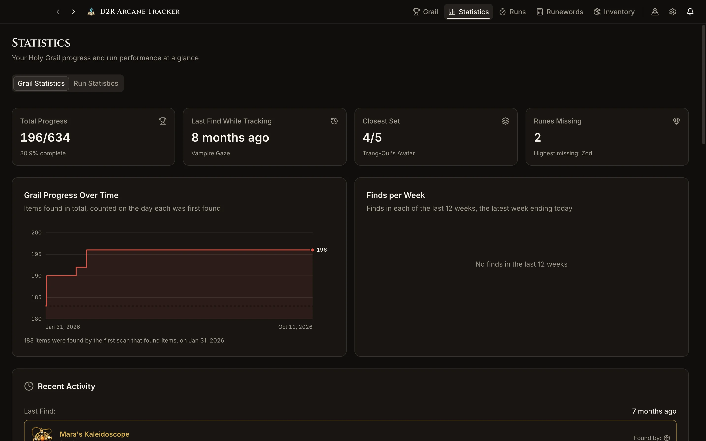
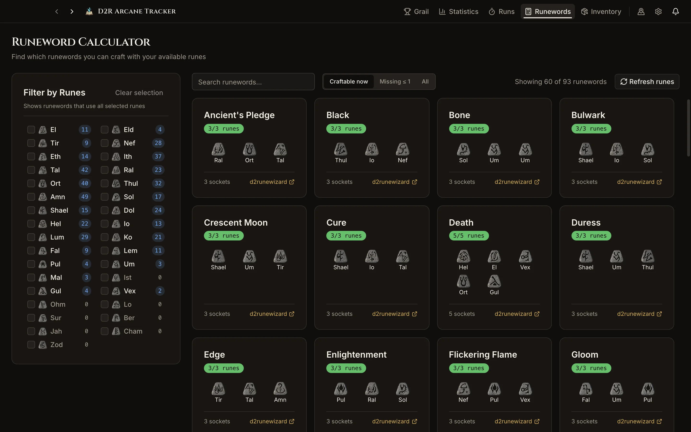
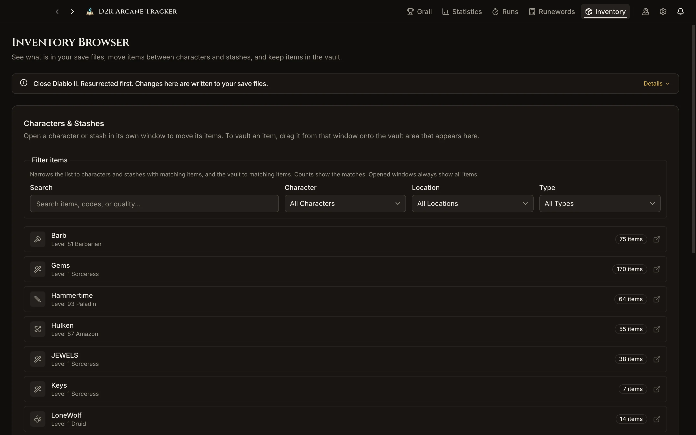

# D2R Arcane Tracker

A desktop Holy Grail tracker for Diablo II: Resurrected. It reads your save files and records every unique, set item, rune and runeword you find, without you having to enter anything.

[Website](https://d2rarcanetracker.com/) · [Download](https://github.com/hyperremix/d2r-arcane-tracker/releases/latest)

| Item details | Statistics |
| --- | --- |
|  |  |
| **Runeword Calculator** | **Inventory Browser** |
|  |  |

## Features

- **Automatic detection**: watches your save folder and logs new grail items from characters and the shared stash.
- **Configurable grail**: track normal and ethereal items, runes and runewords, for softcore, hardcore or both.
- **Run Tracker**: farming sessions with per-run timing and loot, started automatically or with keyboard shortcuts. CSV, JSON and text export.
- **Runeword Calculator**: shows which runewords you can make with the runes you have.
- **Inventory Browser**: see what's in every character and shared stash, move items between them and keep items in a vault. Each character also has an overview with unclaimed quest rewards, missing waypoints and gear totals.
- **Terror Zone Configuration**: choose which terror zones the game rotates through.
- **Overlay widget, statistics and notifications**.
- **Save file snapshots**: keeps copies of your save files whenever they change and restores an earlier one.
- **Grail import and export**: JSON and CSV export, and import from those files, Nasicus/d2-holy-grail exports or a CSV list of item names.
- **Local only**: data lives in a SQLite database on your machine.

## Install

### Windows

Requires Windows 10 or later (64-bit) and Diablo II: Resurrected.

1. Download `D2R-Arcane-Tracker-Windows-<version>-Setup.exe` from the [latest release](https://github.com/hyperremix/d2r-arcane-tracker/releases/latest).
2. Run the installer. The app isn't code-signed, so Windows may show "Windows protected your PC". Click **More info → Run anyway**.
3. Start the app and follow the setup wizard. Your save folder is usually `%USERPROFILE%\Saved Games\Diablo II Resurrected`.

### Linux and Steam Deck

For D2R running through Proton or Wine: the Steam release, Battle.net added to Steam as a non-Steam game, Lutris, Heroic, Bottles or plain Wine. Requires a 64-bit (x64) Linux.

1. On a Steam Deck, switch to **Desktop Mode** first.
2. Download `D2R-Arcane-Tracker-Linux.AppImage` from the [latest release](https://github.com/hyperremix/d2r-arcane-tracker/releases/latest).
3. Make it executable: right-click it, open **Properties → Permissions** and tick **Is executable**, or run `chmod +x D2R-Arcane-Tracker-Linux.AppImage`.
4. Start it and follow the setup wizard. The app looks for your save folder inside the game's Wine or Proton prefix and fills it in, for example `~/.local/share/Steam/steamapps/compatdata/<ID>/pfx/drive_c/users/steamuser/Saved Games/Diablo II Resurrected`. It checks Steam (including libraries on an SD card), Lutris (`~/Games`), Heroic (`~/Games/Heroic/Prefixes`), Bottles and `~/.wine`. If it finds nothing, or picks the wrong prefix, click **Browse**. The folders start with a dot, so they're hidden in the file dialog; press `Ctrl+H` to show them.

Good to know:

- If the AppImage doesn't start and mentions FUSE, install your distribution's `libfuse2` package, or start it with `--appimage-extract-and-run`.
- On distributions that restrict unprivileged user namespaces (for example Ubuntu 24.04), the AppImage's Chromium sandbox may stop it from starting. This hasn't been tested.
- In Game Mode, Steam shows one game at a time. Play in Desktop Mode to keep the tracker open next to D2R. You can add the AppImage to Steam with **Add a Non-Steam Game** to start it from Game Mode.
- Run Tracker [auto mode](docs/RUN_TRACKER.md#auto-mode-windows-only) is Windows-only. Use the manual controls and shortcuts instead.
- Linux support is new and hasn't been tested on a Steam Deck yet. If something doesn't work, please [open an issue](https://github.com/hyperremix/d2r-arcane-tracker/issues).

The app checks for updates on startup and installs them when you confirm. On Linux this updates the AppImage file in place, so keep it in a folder you can write to.

## Documentation

| Guide | Covers |
| --- | --- |
| [Holy Grail Guide](docs/HOLY_GRAIL_GUIDE.md) | The challenge, setup, tracking options, how detection works, and the other app features |
| [Inventory Browser Guide](docs/INVENTORY_BROWSER_GUIDE.md) | Browsing, moving and vaulting items in your save files, the character overview, and the safety rules |
| [Run Tracker Guide](docs/RUN_TRACKER.md) | Sessions, runs, auto mode, shortcuts and exports |
| [Terror Zone Configuration](docs/TERROR_ZONE_CONFIGURATION.md) | Changing the terror zone rotation |
| [Extracting Game Files](docs/EXTRACTING_GAME_FILES.md) | CASC extraction, needed for item icons and terror zones |
| [Tracker Comparison](docs/COMPARISON.md) | How this app compares to other grail trackers |

## Troubleshooting

- **No characters show up**: check the save folder in **Settings → Save file monitoring** and make sure you have created at least one character.
- **Items don't update**: D2R only writes save files when you leave a game, so new items show up after you exit to the menu.
- **Antivirus blocks the app**: add an exception for the install folder. Unsigned Electron apps sometimes cause false positives.
- **Run detection stopped after a game patch**: see [Run Tracker troubleshooting](docs/RUN_TRACKER.md#troubleshooting).
- **A page shows "Something went wrong"**: see [Error screen](docs/HOLY_GRAIL_GUIDE.md#error-screen).

If that doesn't help, search the [issues](https://github.com/hyperremix/d2r-arcane-tracker/issues) or open a new one, or ask in [Discussions](https://github.com/hyperremix/d2r-arcane-tracker/discussions).

## Contributing

See [CONTRIBUTING.md](CONTRIBUTING.md). To report a vulnerability, see [SECURITY.md](SECURITY.md).

## License

[MIT](LICENSE). Diablo II: Resurrected is a trademark of Blizzard Entertainment, and this project isn't affiliated with Blizzard. See [Third-Party Licenses and Legal](docs/THIRD_PARTY_LICENSES.md).
